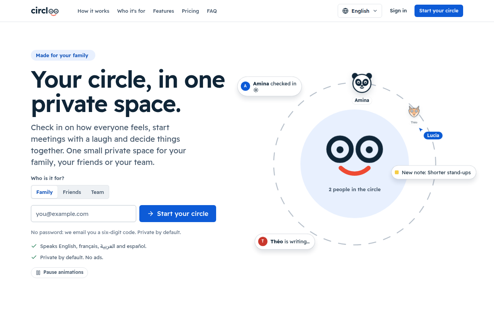
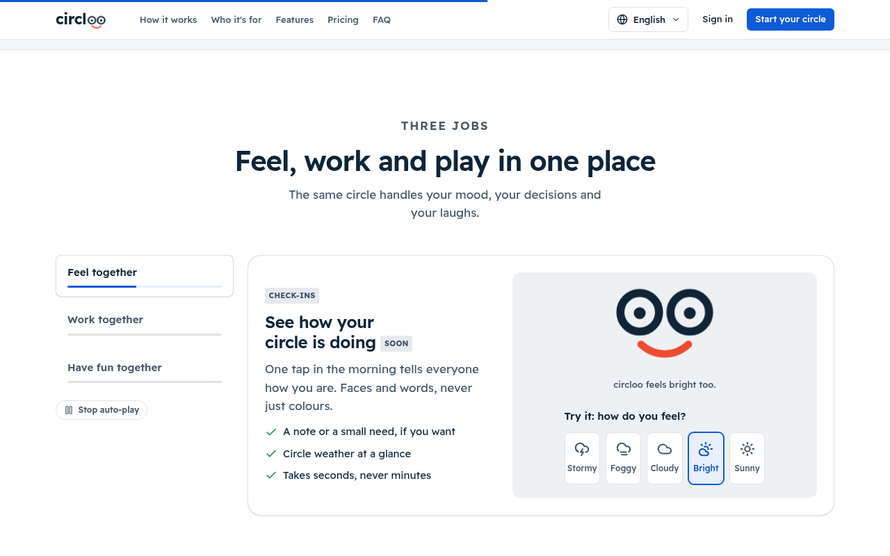
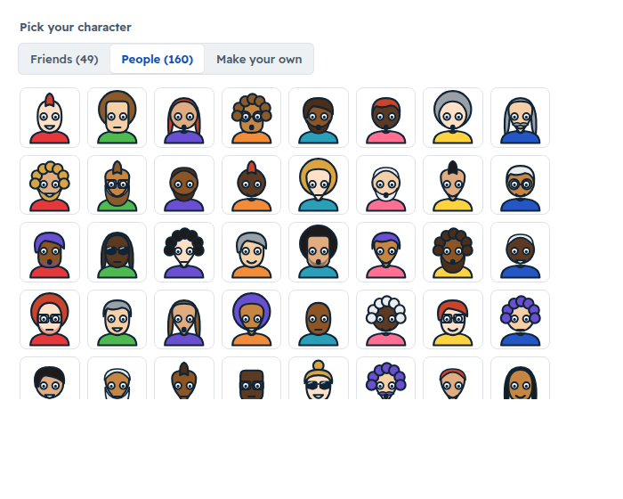
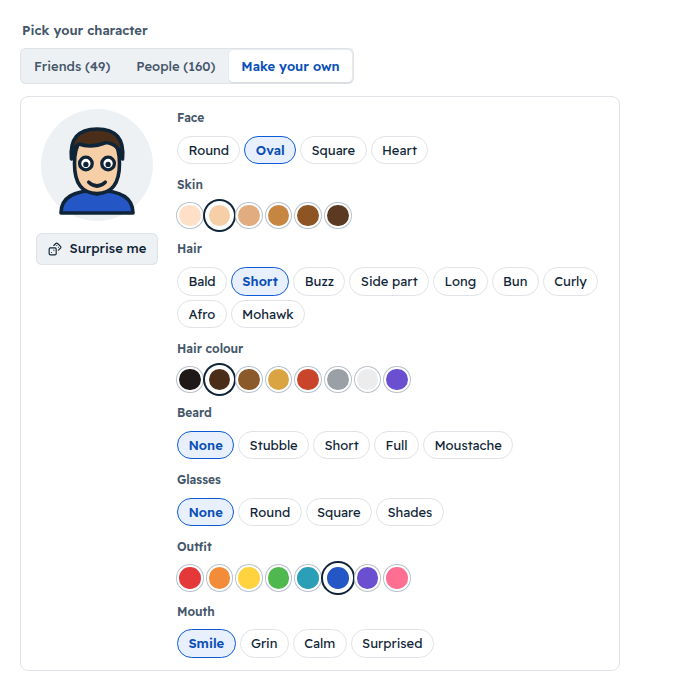
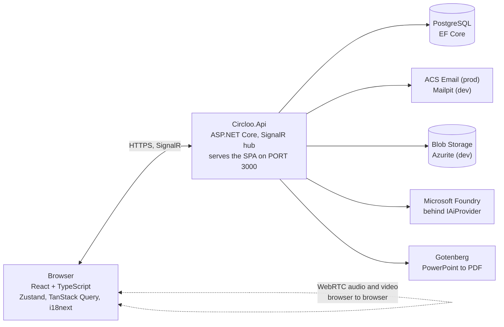
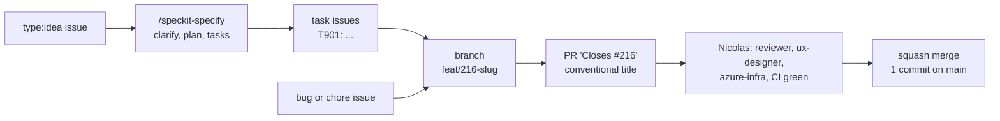

<p align="center">
  
</p>

<h1 align="center">circloo</h1>

<p align="center">
  <b>A small private space for your circle: family, friends or team.</b><br>
  Check in on how everyone feels, start meetings with a laugh and decide things together, in English, français, العربية and español.
</p>

<p align="center">
  <a href="https://github.com/nciross/circloo/actions/workflows/pr-checks.yml"></a>
  
  
  
  
</p>

<p align="center">
  
</p>

---

## What circloo is

The same small space works for your family dinner planning and your team retro. Fun and feelings sit next to work as first-class content, and the whole thing speaks four languages natively, including right-to-left Arabic.

| | |
|---|---|
| **Feel together** | One tap tells your circle how you are. Words and faces, never just colours. |
| **Work together** | Live boards and a shared canvas for brainstorms, retros and decisions: notes, votes, live pointers. Presentations with live polls and quizzes. |
| **Have fun together** | Icebreakers, riddles and jokes written by people in each language, plus fresh cards from circloo, checked for kindness. |
| **Join easily** | Sign up with an email code (no password), or join a circle with a link or short code and just a first name. |
| **Plug in your company** | Teams, Jira, Confluence and Notion; single sign-on is configuration, never customer-specific code. |

<p align="center">
  
</p>

### Characters, not avatars

Everyone picks a character to be in the circle: 49 friends (animals, heroes, plants, a few strange ones and an anonymous silhouette), 160 ready-made people, or **build your own** from face, skin, hair, beard, glasses, outfit and mouth, about 1.1 million combinations. People who pick the same character get a colour ring so you can still tell them apart.

<p align="center">
  
  
</p>

## Where it stands

circloo is built feature by feature through [Spec-Kit](.specify/) specs. This table is the honest picture; the specs in [`specs/`](specs/) have the detail.

| Area | State | Spec |
|---|---|---|
| Passwordless sign-up (email code), public landing page in 4 languages | Live | [001](specs/001-platform-otp-landing/) |
| Icebreakers and jokes, AI cards (Microsoft Foundry behind `IAiProvider`) | Live | [002](specs/002-ai-icebreakers/) |
| Live circles: invite by link or code, join as a guest, characters and rings | Live | [003](specs/003-live-circles/), [008](specs/008-live-room-big-circles/) |
| Live boards and canvas | Live | [004](specs/004-live-boards/) |
| Pirikoo, the parakeet who guides new circles and answers questions in the chat | Live | [#84](https://github.com/nciross/circloo/pull/87), [#88](https://github.com/nciross/circloo/pull/90) |
| Integrations: Teams, Jira, Confluence, Notion (Salesforce is coming) | Live, partly | [005](specs/005-integrations/) |
| Presentations: PowerPoint decks with live polls and quizzes | Live | [006](specs/006-live-presentations/) |
| Polls, Q&A and feedback forms (servers merged, screens next) | In progress | [007](specs/007-circle-polls-qa-forms/) |
| Big circles (up to 100): sidebar, chat, reactions, raised hands | In progress | [008](specs/008-live-room-big-circles/) |
| **Live discussion**: audio and video stage, raise a hand, text-only session record | In progress, 2 of 15 tasks merged | [009](specs/009-live-discussion-stage/) |
| Daily mood check-in, notifications and digest | Planned | [PRD](docs/product/prd.md) |
| Per-organization SSO (OIDC and SAML) | Planned | [overview](docs/architecture/overview.md) |

Pricing is undecided. During early access circloo is free, and if that ever changes you will hear about it well before anything is charged.

## Privacy, in plain words

- **Private by default.** Only members and invitees see what happens in a circle. No ads.
- **No media stored.** Live discussion audio and video go browser to browser and never pass through or rest on circloo servers. "Recording a session" saves a **text** transcript only (messages, raised hands, who was on stage), and only the animator can start it, read it or delete it.
- **The animator decides.** Live discussion is off until the animator turns it on, and every moderator action is checked on the server, never trusted from the browser.
- **Passwordless.** One-time codes are stored as an HMAC and are single use; sessions are server-side and revocable; every unsafe request needs a CSRF token; the CSP allows no inline scripts. See [Security by design](docs/architecture/overview.md#security-by-design-constitution-viii).

## Run it locally (costs nothing)

You need the **.NET 10 SDK**, **Node 24** and **Docker Desktop or Podman** (`podman machine start`, then `ASPIRE_CONTAINER_RUNTIME=podman`). The `.ps1` scripts need PowerShell 7 (`pwsh`); each has a bash twin (`.sh`).

```powershell
git clone https://github.com/nciross/circloo.git
cd circloo
./scripts/setup.ps1                           # GitHub login, git hooks, labels  (bash: ./scripts/setup.sh)
cd src/web; npm ci; cd ../..
dotnet run --project src/Circloo.AppHost      # Postgres, Mailpit, Azurite, deck converter, API and Vite, all local
```

Open the Aspire dashboard link it prints. Use the `web` endpoint for the app and the `mailpit` endpoint to read your sign-in codes: no email ever leaves your machine. The deck converter image is about 1.7 GB the first time.

```powershell
dotnet test                                   # API tests against a real Postgres through Testcontainers
cd src/web
npm test                                      # Vitest
npm run lint; npm run typecheck               # oxlint (warnings fail) and tsc
npx playwright test                           # e2e, with E2E_BASE_URL and MAILPIT_URL set
```

<details>
<summary>Ran the AppHost before issue #139? Do this once.</summary>

Azurite used to be a long-lived container. Stop the AppHost, find the old one with `podman ps -a --filter name=storage-` (or `docker ps -a --filter name=storage-`), remove it with `podman rm -f <name>` (the `circloo-azurite` volume keeps your slides) and start the AppHost again. Otherwise two Azurite processes can end up writing the same volume.
</details>

### Ship it to Azure, or make it vanish

One resource group per environment, one command each way:

```powershell
./scripts/deploy.ps1  -Environment dev        # azd up -> rg-circloo-dev
./scripts/destroy.ps1 -Environment dev        # azd down --purge (the whole resource group)
```

## How it is built



- **App:** [.NET Aspire](src/Circloo.AppHost) orchestrates everything locally. [`src/Circloo.Api`](src/Circloo.Api) is the ASP.NET Core minimal API (EF Core, SignalR); [`src/web`](src/web) is the React SPA. In production a single container serves both.
- **Infra:** [`infra/`](infra/) is Bicep for one resource group, `rg-circloo-<env>`: Container Apps, ACR, Postgres Flexible Server, ACS Email, Storage, Key Vault, Log Analytics and Application Insights, with a user-assigned identity. App secrets are Key Vault references. New Azure resources go into the Bicep, never the portal.
- **Fun content:** seed icebreakers and jokes live in [`content/fun/`](content/fun/) (`en`, `fr`, `ar`, `es`). They are written natively per language and kept kind, never translated word for word.
- **Design:** one action blue, violet only for AI, and a logo that feels what you feel. See [`DESIGN.md`](DESIGN.md) and the [no-AI-look rules](docs/design/anti-ai-look.md). Every string exists in all four locales, and layout uses logical CSS properties so Arabic is a first-class direction.

<details>
<summary>Repository layout</summary>

```
src/Circloo.AppHost/        Aspire: Postgres, Mailpit, Azurite, converter, API, Vite
src/Circloo.ServiceDefaults/ telemetry, health, resilience
src/Circloo.Api/            Auth, Circles (hub, endpoints), Discussion, Decide, Presentations, Pirikoo, Integrations, Data (EF)
src/web/                    React app: features/, components/, i18n/locales, styles/, e2e/
tests/Circloo.Api.Tests/    xUnit + Testcontainers
infra/                      Bicep (subscription scope) and azd
content/fun/                icebreakers and jokes in four languages
specs/                      Spec-Kit specs, plans, contracts and tasks, one folder per feature
docs/                       product, architecture, design and workflow
video/                      Remotion project that renders the landing story clips
scripts/                    setup, deploy, destroy, protect-repo, git hooks
```
</details>

## How we work

**No issue, no development.** Every change starts as a GitHub issue and ends as one squash commit on `main`, and `main` only changes through a reviewed pull request.



- **Branches** are `<type>/<number>-<slug>`; **commits** and **PR titles** are [Conventional Commits](docs/workflow/git-conventions.md) with the issue number, for example `feat(discussion): foundation and animator switch (#216)`. Git hooks (enabled by `scripts/setup`) and CI reject anything else, and nothing can be pushed to `main`.
- **Nicolas** is the lead maintainer agent: he reviews a PR against its issue, spec and the [constitution](.specify/memory/constitution.md), fixes small things, and merges only when every gate passes. He never merges on pending or failing CI, never uses `--admin` and never force-pushes. See [docs/workflow/nicolas.md](docs/workflow/nicolas.md).
- **UI work** goes through the Impeccable design plugin when it is installed, and a manual review against the no-AI-look rules when it is not. Nothing may look AI-generated.

Start here, in this order:

1. [`PRODUCT.md`](PRODUCT.md): who it is for, voice, principles. Nothing in it may be invented.
2. [`docs/product/prd.md`](docs/product/prd.md): the epics.
3. [`.specify/memory/constitution.md`](.specify/memory/constitution.md): the binding rules.
4. [`docs/architecture/overview.md`](docs/architecture/overview.md): stack, settings, SSO and invite model.
5. [`docs/workflow/issue-driven-development.md`](docs/workflow/issue-driven-development.md) and [`CLAUDE.md`](CLAUDE.md) if you work with Claude Code.

## Contributing

1. Find or open an issue (idea, task, bug or chore). No issue, no development.
2. Branch from `main` as `<type>/<number>-<slug>` and commit with the issue number.
3. Open a PR whose description says `Closes #N`; fill in the checklist honestly, including what you did not run.
4. Review kindly: roast the code, never the coder.

A few house rules: pull before you push, write commit messages a human can read, and keep jokes kind. Fun is a feature here.

---

<p align="center"><i>Made by the circloo crew, for circles of every size.</i></p>
